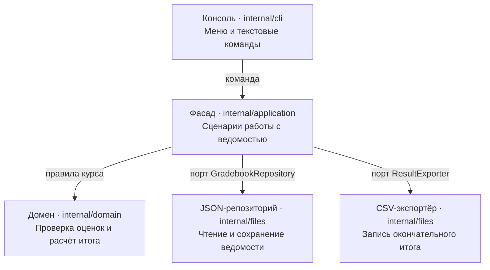

# ПОС

«Преподавательская оценка студентов» — консольное приложение для ведения ведомости одного курса. Оно хранит студентов, критерии рубрикатора и выставленные оценки, рассчитывает взвешенный итог по студенту и выгружает его в CSV. Проект выполнен на Go в рамках ДЗ‑2 по КПО.

## Запуск

Требуется Go 1.22 или новее. Команды выполняются из каталога с `go.mod`.

```text
go mod download
go run .
```

Приложение открывает меню на русском языке. Введите номер действия и нажмите Enter. Для каждого поля появится отдельная подсказка. Например, пункт `2` запрашивает ID и имя нового студента. Имя с пробелами в меню вводится одной строкой без кавычек. Пункт `6` запрашивает ID студента, ID критерия и балл. Пункт `0` завершает работу.

Для запуска одного действия из терминала доступны команды из следующего раздела. Справка выводится командой `go run . help`. Оба режима используют одну и ту же ведомость. Команда `go test -run TestDemo -v .` запускает сквозной сценарий на временных данных.

## Консольные команды

По умолчанию ведомость сохраняется в `gradebook.json` в рабочем каталоге. Флаг `-data JSON_PATH` задаёт другой файл и указывается перед командой.

`STUDENT_ID` и `CRITERION_ID` — идентификаторы, заданные при добавлении студента и критерия. Можно использовать кириллицу или латиницу. Короткие ID латиницей, например `s1` и `labs`, удобнее вводить в терминале. Имена и названия также могут быть на русском или английском. В команде терминала имя с пробелом передают в кавычках (`"Анна Иванова"`), в меню его вводят одной строкой (`Анна Иванова`).

| Команда | Действие |
| --- | --- |
| `add-student STUDENT_ID "NAME"` | Добавить студента с указанным ID и именем |
| `students` | Показать студентов |
| `add-criterion CRITERION_ID "TITLE" MAX_POINTS WEIGHT` | Добавить критерий с названием, максимальным баллом и весом |
| `criteria` | Показать рубрикатор |
| `add-evaluation STUDENT_ID CRITERION_ID POINTS` | Выставить новую оценку |
| `evaluations STUDENT_ID` | Показать выставленные оценки студента |
| `correct-evaluation STUDENT_ID CRITERION_ID POINTS` | Исправить выставленную оценку |
| `cancel-evaluation STUDENT_ID CRITERION_ID` | Отменить выставленную оценку |
| `result STUDENT_ID` | Показать текущий итог и заполненность рубрикатора |
| `export STUDENT_ID CSV_PATH` | Выгрузить окончательный итог одного студента в новый CSV-файл |

## Сквозной сценарий

Ручной сценарий создаёт ведомость `demo-gradebook.json` и выгружает итог в `result.csv`. Для повторного запуска используйте новые имена файлов.

```text
go run . -data demo-gradebook.json add-student s1 "Анна Иванова"
go run . -data demo-gradebook.json add-criterion labs "Лабораторные" 10 60
go run . -data demo-gradebook.json add-criterion project "Проект" 20 40
go run . -data demo-gradebook.json students
go run . -data demo-gradebook.json criteria
go run . -data demo-gradebook.json add-evaluation s1 labs 8
go run . -data demo-gradebook.json result s1
go run . -data demo-gradebook.json add-evaluation s1 project 15
go run . -data demo-gradebook.json evaluations s1
go run . -data demo-gradebook.json result s1
go run . -data demo-gradebook.json export s1 result.csv
```

После первой оценки итог составляет 80/100 при одном заполненном критерии из двух. После второй оценки отдельный запуск читает сохранённую ведомость и показывает 78/100. CSV содержит одну запись.

```csv
student_id,student_name,result_percent
s1,Анна Иванова,78.00
```

## Расчёт итога

Вклад оценённого критерия равен `(балл / максимальный балл) × вес`. Итог по шкале от 0 до 100 равен сумме вкладов, делённой на сумму весов оценённых критериев и умноженной на 100.

| Состояние ведомости | Расчёт | Итог |
| --- | --- | --- |
| Лабораторные `8/10` (вес 60), проект ещё без оценки | `100 × (8/10 × 60) / 60` | 80/100, оценён 1 из 2 критериев |
| За проект выставили `15/20` (вес 40) | `100 × (8/10 × 60 + 15/20 × 40) / 100` | 78/100, оценены оба критерия |
| Оценку за проект исправили на `0/20` | `100 × (8/10 × 60 + 0/20 × 40) / 100` | 48/100, экспорт доступен |
| Оценку за проект отменили | `100 × (8/10 × 60) / 60` | 80/100, экспорт снова недоступен |

Для этой ведомости выбрана шкала 0–100. Баллы, максимумы и веса задаются целыми числами. Веса относительны, поэтому их сумма может отличаться от 100. Текущий итог показывает успеваемость по проверенным работам, а счётчик рядом с ним — сколько критериев уже оценено. Выставленный ноль учитывается со своим весом. При пустом рубрикаторе или отсутствии оценок итог недоступен. В CSV выгружается окончательный итог одного студента после заполнения всех его критериев. Округление до двух знаков выполняется при выводе и экспорте.

## Доменная модель

Единый язык предметной области (Ubiquitous Language) используется в командах, модели и тестах. Основные понятия — ведомость, студент, критерий, балл, оценка и итог.

| Термин | Где в коде | Ответственность |
| --- | --- | --- |
| Ведомость | [Gradebook](internal/domain/gradebook.go) | Корень агрегата одного курса. Объединяет студентов, рубрикатор и оценки, чтобы при изменении оценки проверить данные в пределах одной ведомости. |
| Студент и критерий | [Student, Criterion](internal/domain/gradebook.go) | Сущности (Entity) с устойчивыми ID. У двух студентов с одинаковым именем могут быть разные ID. Критерий задаёт максимальный балл и вес. |
| Балл и оценка | [Score, Evaluation](internal/domain/evaluation.go) | `Score` — Value Object. Два балла со значением 8 равны как значения. `Evaluation` связывает балл со студентом и критерием. |
| Итог | [CalculateResult](internal/domain/result.go) | Domain Service рассчитывает итог по оценкам студента и рубрикатору. Итог вычисляется при запросе. |
| Репозиторий | [GradebookRepository](internal/application/facade.go) | Порт приложения для загрузки и обновления агрегата. Хранение в JSON реализовано файловым адаптером. |

Ведомость допускает одну текущую оценку на пару «студент + критерий». Студент и критерий должны присутствовать в ведомости, балл должен быть в пределах от 0 до максимума критерия включительно, а максимум и вес критерия должны быть положительными. При ошибке исправления сохраняется прежняя оценка. После отмены критерий считается неоценённым. При чтении JSON данные проходят те же проверки, что и при вводе через консоль.

## Архитектура и DI

Приложение построено по Ports and Adapters. Схема читается сверху вниз. Консоль передаёт команду фасаду, который обращается к нужным компонентам. Подписи на стрелках показывают назначение вызова.



Зависимости в коде направлены внутрь: `cli → application → domain`. Интерфейсы `GradebookRepository` и `ResultExporter` объявлены в `application`. Пакет `files` предоставляет их реализации, поэтому фасад может работать с ведомостью без привязки к формату файла.

В точке сборки `main.go` вызовы `Provide` регистрируют JSON-репозиторий как `GradebookRepository`, CSV-экспортёр как `ResultExporter`, поток вывода и конструкторы фасада и консоли. При вызове `Invoke` Dig собирает консоль с этими зависимостями. В тестах домена ведомость создаётся напрямую. [Точка сборки](main.go)

### Исправление оценки

Пусть у студента `s1` за лабораторные стоит 8 баллов из 10. При вызове `correct-evaluation s1 labs 12` консоль передаёт фасаду два ID и новый балл. Метод репозитория `Update` загружает ведомость. Внутри агрегата доступны и прежняя запись, и критерий с его максимумом: проверить оба условия можно в рамках одного изменения. Корень агрегата находит существующую оценку по паре ID, а фабрика отклоняет новый балл.

Фасад возвращает ошибку в консоль. До записи файла дело доходит только после успешного изменения, поэтому на диске остаются прежние 8 баллов. Корректное исправление, например на 7, заменяет оценку по той же паре ID. Следующий запрос рассчитывает итог уже из сохранённого значения. [Методы ведомости](internal/domain/gradebook.go) · [Обновление JSON](internal/files/json_repository.go)

### Экспорт окончательного итога

Пункт 10 меню и команда `export s1 result.csv` вызывают один сценарий. Фасад загружает ведомость через репозиторий и запрашивает итог в режиме `FinalResult`. Если у студента есть оценки по всем критериям, фасад передаёт результат CSV-экспортёру. Если оценок не хватает, консоль сообщает причину отказа до создания файла.

## Паттерны проектирования

| Группа | Паттерн | Задача |
| --- | --- | --- |
| Порождающий | [Фабрика оценки](internal/domain/evaluation.go) | Через `newEvaluation` проходят выставление, исправление и восстановление оценок из JSON. Все три операции используют одну проверку студента, критерия и балла. |
| Структурный | [Facade](internal/application/facade.go) | Даёт консоли одну точку входа в сценарии. Фасад координирует загрузку ведомости, доменные операции, сохранение и экспорт. |
| Поведенческий | [Strategy](internal/domain/result.go) | Фасад выбирает `CurrentResult` для просмотра и `FinalResult` для экспорта. Метод стратегии `checkCompleteness` получает число выставленных оценок и размер рубрикатора. Первый режим допускает хотя бы одну оценку, второй требует заполнения всех критериев. Взвешенную сумму в обоих случаях вычисляет `CalculateResult`. |

## Сборка и тестирование

```text
go vet ./...
go test ./...
go build ./...
```

Юнит-тесты проверяют границы балла, неизвестный критерий, исправление и отмену оценки, пустой рубрикатор и расчёт итога. Сквозной тест запускает команды просмотра списков и проверяет изменение результата после исправления оценки на ноль и отмены. Он также проверяет повторное чтение JSON, отказ в экспорте при неполных оценках и содержимое итогового CSV.

Тест с двумя студентами проверяет независимость оценок по одному критерию. После исправления и отмены оценки первого студента у второго сохраняются 9 из 10 за лабораторные и текущий итог 90/100.

### Тесты файловых адаптеров

Команда `go test -v ./internal/files` запускает тесты с временными файлами.

| Сценарий | Ожидаемое поведение |
| --- | --- |
| Оборванный JSON, отсутствующее поле `points`, балл выше максимума или неизвестный критерий | Загрузка возвращает ошибку до начала изменения ведомости. Исходный файл сохраняется побайтово. |
| Попытка исправить 8/10 на 12/10, затем на 0/10 | Первая операция отклоняется и сохраняет исходный JSON. Вторая проходит. После повторной загрузки единственный критерий заполнен, а окончательный итог равен нулю. |
| Экспорт студента с именем `Анна, группа "Б"` | При чтении CSV имя с запятой и кавычками целиком попадает в одно поле, процент — в отдельное. |
| Повторный экспорт по тому же пути | Экспортёр возвращает ошибку, содержимое первого отчёта сохраняется побайтово. |

Исходники тестов — [JSON-репозиторий](internal/files/json_repository_test.go) и [CSV-экспортёр](internal/files/csv_exporter_test.go).

